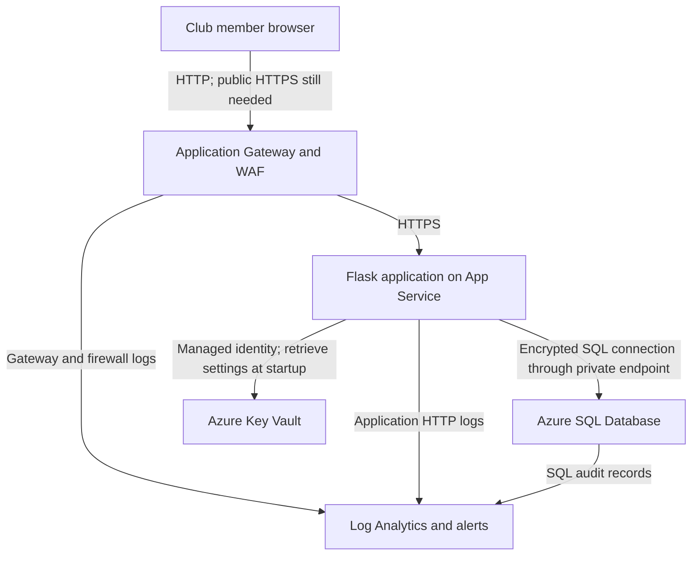

# Club XYZ: Azure Cloud Migration and Security

**Author:** Cedric Titus  
**Program:** B Cloud Engineers  
**Project period:** September 1 - October 1, 2026

## Project summary

This project follows the migration of a sample club member-management application from a local Flask application to Microsoft Azure. Club XYZ is the fictional client used for the training scenario.

I worked on Azure SQL migration, application identity, database encryption, network restrictions, web request inspection, monitoring, and recovery testing. This repository contains the application code, scripts, security documentation, cost model, and executive presentation.

**Status:** Training lab with documented tests and remaining work before production use.

## Presentation

[View the final 18-slide presentation (PDF)](Club_XYZ_Final_18_Slides%20%281%29%20%281%29.pdf)

## Architecture

This diagram follows the request path recorded in the network and customer-journey documentation.

The documented SQL path uses VNet integration, a private endpoint, and private DNS. SQL public network access was disabled. The database uses encryption at rest, and the application-to-database connection uses encryption in transit.

The application's Azure identity is separate from member sign-in. Club users still sign in with application usernames and passwords.

## Recorded results

- Tested SQL injection, cross-site scripting, and traversal patterns received HTTP 403 responses with the WAF in Prevention mode.
- A test member signup was traced through gateway, application, Key Vault, and SQL evidence, with correlation limits documented.
- A database restore took **6 minutes 26 seconds**. Restore plus data checking took approximately **17-18 minutes**. Both databases showed **7 user records**.
- The cost model estimates **$312.10/month** for Azure infrastructure. The middle three-year estimate is **$18,515.60**, including delivery labor and routine support.

Costs are planning estimates, not invoices. The restore test does not establish full application recovery or guaranteed recovery times.

## Documentation

| File | What it covers |
|---|---|
| [IDENTITY_ARCHITECTURE.md](IDENTITY_ARCHITECTURE.md) | Identity setup and the earlier authentication migration stage |
| [ACCESS_REVIEW.md](ACCESS_REVIEW.md) | Role assignments, access scope, and review recommendations |
| [NETWORK_ARCHITECTURE.md](NETWORK_ARCHITECTURE.md) | Gateway routing, private SQL access, network tests, and limitations |
| [DETECTION_AND_MONITORING.md](DETECTION_AND_MONITORING.md) | Logging, alerts, dashboard evidence, and detection gaps |
| [CUSTOMER_JOURNEY.md](CUSTOMER_JOURNEY.md) | A test signup traced through the recorded security evidence |
| [COST_AND_RESILIENCE.md](COST_AND_RESILIENCE.md) | Cost scenarios, restore results, and proposed recovery targets |
| [PROJECT_QUOTE.md](PROJECT_QUOTE.md) | Delivery scope, labor, operating costs, and exclusions |
| [ENCRYPTION_SUMMARY.md](ENCRYPTION_SUMMARY.md) | Database encryption and connection-security documentation |

Documents capture different project stages. The later customer trace records managed-identity SQL authentication after the earlier identity setup document.

## Code, scripts, and queries

| File or folder | Purpose |
|---|---|
| [app.py](app.py) and [templates/](templates/) | Flask application, sign-in, dashboard, and member creation |
| [requirements.txt](requirements.txt) | Python dependencies |
| [run.ps1](run.ps1) | Application launch script |
| [access_review.ps1](access_review.ps1) | Azure role-assignment review script |
| [SECURITY_QUERIES.kql](SECURITY_QUERIES.kql) | Monitoring and investigation queries |
| [migrate_data.py](migrate_data.py) and [migrate_schema.sql](migrate_schema.sql) | Database migration helpers |
| [azure_connection.py](azure_connection.py), [store_connection_secret.py](store_connection_secret.py), and [verify_encryption.py](verify_encryption.py) | Earlier connection, secret-management, and encryption helpers |
| [init_db.py](init_db.py) | Historical demo-data reset script; deletes existing users before seeding accounts |

The current application requires private configuration for `FLASK_SECRET_KEY`, `KEY_VAULT_NAME`, and the Key Vault secret named `sql-connection-passwordless`, together with appropriate Azure permissions, network access, and the SQL ODBC driver. Review the historical scripts before use. Do not run the demo reset against a database containing information you need to keep.

## Remaining work

- Complete HTTPS for the public browser-to-gateway connection.
- Enforce administrator permissions on member creation and add clear login outcome logs.
- Finish access reviews and verify alert email delivery.
- Establish a private database administration route and review private-endpoint network policies.
- Test the complete application recovery process and any proposed replication or failover configuration.

These items must be addressed and tested before treating the lab as a production deployment.
